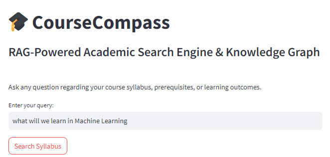
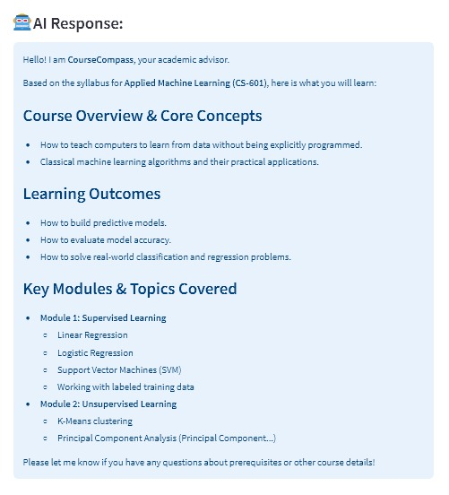
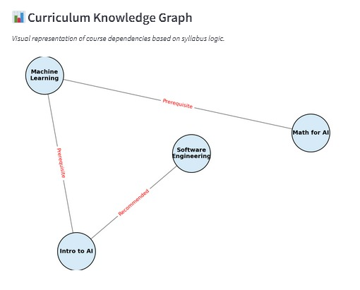

# 🎓 CourseCompass: RAG-Powered Academic Search Engine & Knowledge Graph


## 📌 Project Overview
**CourseCompass** is an enterprise-grade, intelligent academic advisor built to bridge the semantic gap in university syllabi. Traditional PDFs rely on simple keyword searches (Ctrl+F), leaving natural-language queries unanswered and course prerequisites hidden. 

This project implements an advanced **Retrieval-Augmented Generation (RAG)** pipeline that dynamically extracts context from curriculum PDFs, generates beautifully formatted Markdown answers using the **Google Gemini LLM**, and renders a **Dynamic Knowledge Graph** of course dependencies in real-time.

---

## 🚀 Key Features Built for Scale
* **Hybrid Retrieval System:** Implemented both **FAISS (Semantic Vector Search)** and **BM25 (Lexical/Keyword Search)**, fused using custom Reciprocal Rank Fusion (RRF) logic to ensure highly accurate, grounded context retrieval.
* **Zero Hallucination Generation:** Enforced strict LLM prompt boundaries to ensure the Gemini model strictly answers from the retrieved syllabus context and explicitly declines out-of-scope questions.
* **Dynamic Subgraph Extraction:** Utilized **NetworkX** to map the entire curriculum as a Directed Graph (`nx.DiGraph`). Instead of static images, the system uses the `ancestors()` algorithm to dynamically extract and render only the specific prerequisite paths related to the user's query.
* **Enterprise Error Handling:** Engineered robust retry mechanisms with exponential backoff to handle Google Cloud API `503 Overload` errors and bypassed client-side connection timeouts for seamless UI rendering.

---

## 📸 System Interface

### 1. User Interface & Query Input
*(The Streamlit frontend taking natural language queries)*


### 2. The RAG AI Advisor (Markdown Response)
*(The system retrieves context via Hybrid Search and the LLM formats it into structured output)*


### 3. Dynamic Prerequisite Knowledge Graph
*(Real-time Matplotlib render of the exact course dependencies based on the query)*


---

## ⚙️ Technical Architecture
1. **Data Ingestion:** Syllabus PDFs are parsed, chunked, and embedded into a local FAISS index.
2. **Query Processing:** User query is matched against the FAISS index (for meaning) and BM25 index (for exact technical jargon like 'Backpropagation').
3. **Context Fusion:** Top-k documents from both retrievers are ranked and passed into the LLM context window.
4. **Generation & Rendering:** Gemini 3.8 Flash generates a structured Markdown response, while NetworkX calculates the prerequisite nodes and renders the Matplotlib graph simultaneously on the Streamlit frontend.

---

## 🛠️ Tech Stack
* **Language:** Python 3.8
* **Frontend:** Streamlit
* **LLM Engine:** Google Gemini 3.8 Flash API
* **Vector Database & Search:** FAISS (Meta), BM25
* **Graph Visualization:** NetworkX, Matplotlib
* **Data Processing:** Pandas, PyPDF2, LangChain (for chunking)

---

## 💻 Local Installation & Setup

1. **Clone the repository:**
   ```bash
   git clone https://github.com/goswamivishal3738a-crypto/coursecompass-hybrid-rag-graph.git
   cd coursecompass-hybrid-rag-graph